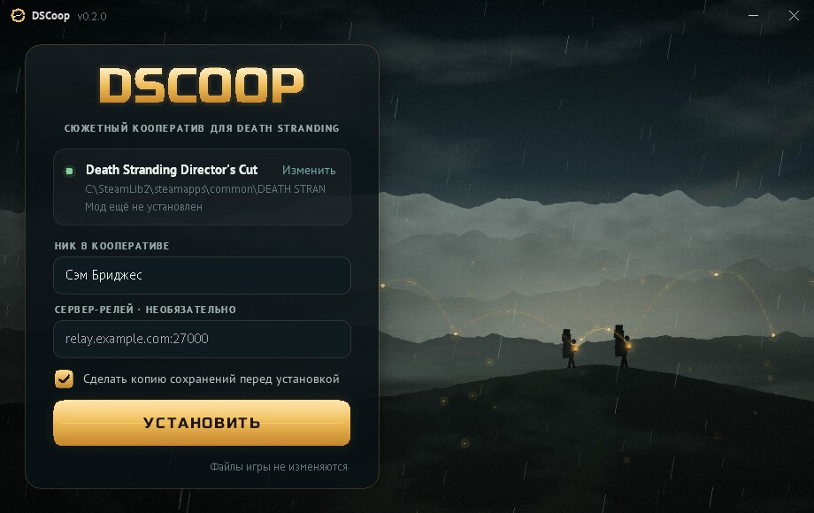
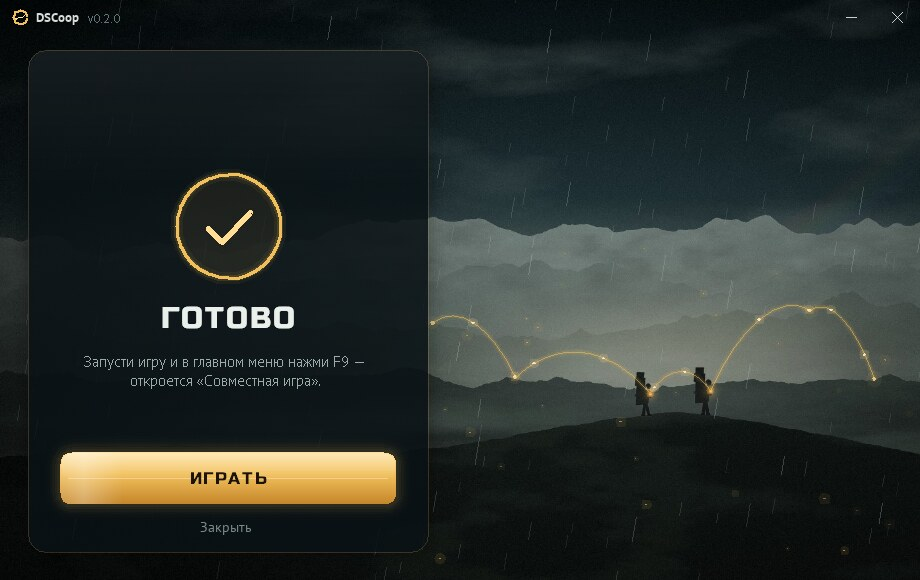

# Установка DSCoop — для игроков

Нужна Death Stranding Director's Cut из Steam. Больше ничего ставить не надо.



## Установить

1. Скачай **DSCoopSetup.exe** со страницы релизов:
   https://github.com/happyg00se/Co-op-ds/releases/latest
2. Закрой игру, если она запущена.
3. Запусти `DSCoopSetup.exe`.
4. Если Windows покажет синее окно «Система Windows защитила ваш компьютер», нажми
   **«Подробнее»**, затем **«Выполнить в любом случае»**. Это предупреждение появляется у всех
   новых программ без платной цифровой подписи.
5. Установщик сам найдёт игру в Steam и подставит твой ник из Steam. Проверь ник, при желании
   впиши адрес сервера-релея, если тебе его дали.
6. Нажми **«Установить»**. Через пару секунд появится «Готово!».
7. Нажми **«Играть»** или запусти игру через Steam.


 В главном меню нажми **F9**: откроется меню
   «Совместная игра».

Если папка игры защищена, Windows один раз спросит разрешение администратора. Это нормально.

## Что делает установщик

- Сначала копирует твои сохранения в `dscoop\backups\` внутри папки игры.
- Кладёт рядом с игрой `version.dll` и папку `dscoop`. Сами файлы игры не меняются.
- Если у тебя уже стоит другой мод с файлом `version.dll`, установщик его не удаляет. Он
  перекладывает его в `dscoop\chain\`, и DSCoop загружает его вместе с собой.
- Регистрирует DSCoop в «Параметры → Приложения», чтобы его можно было удалить как обычную
  программу.

## Обновить

Скачай новый `DSCoopSetup.exe` и нажми «Обновить». Ник и настройки сохранятся.
У всех игроков в одной сессии должна быть одинаковая версия DSCoop.

## Удалить

«Параметры → Приложения → DSCoop → Удалить», или запусти `DSCoopSetup.exe` и нажми «Удалить».
Игра станет обычной. Папка `dscoop` с копиями сохранений и настройками останется, её можно
удалить руками.

## Если игра стоит не в Steam или установщик её не нашёл

Нажми «Выбрать…» и укажи папку, где лежит `ds.exe`.

## Для опытных: тихий режим

```
DSCoopSetup.exe /S [/dir="D:\Games\DEATH STRANDING DIRECTORS CUT"] [/nick=Name] [/relay=host:27000] [/nobackup] [/log=C:\setup.log]
DSCoopSetup.exe /S /uninstall [/purge]
```
Коды выхода: 0 — успех, 1 — ошибка, 2 — игра не найдена, 3 — игра запущена.
